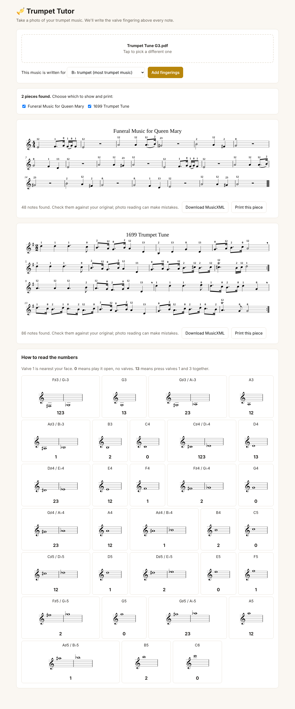

# Trumpet Tutor (prototype)

Upload a photo or PDF of trumpet sheet music; the app re-draws the score with
the B♭ trumpet valve fingering above every note.



## How it works

1. **Read the notes**: [homr](https://github.com/liebharc/homr), an open-source
   optical music recognition (OMR) engine, turns the image into MusicXML. It
   handles phone photos (tilt, uneven light) and takes ~15–30 s per page on a CPU.
2. **Add fingerings**: `app/fingering.py` maps each written pitch (F♯3 to C6)
   to its standard valve combination and inserts it as a MusicXML `<fingering>`
   above the note. A "concert pitch" option transposes up a whole step first,
   for music written for piano, flute or voice.
3. **Beam the short notes**: homr gives note values but not beams, so
   `app/beaming.py` rebuilds them the way engravers group them: one group per
   beat (crotchet beats in 2/4, 3/4, 4/4, 2/2; dotted crotchets in 6/8, 9/8,
   12/8), with semiquaver stubs next to dotted quavers.
4. **Draw the score**: [Verovio](https://www.verovio.org) engraves the
   annotated MusicXML as SVG, keeping the original's line breaks, shown in the browser and printable.

## Run it on GitHub (no install)

1. On the repo page, click **Code → Codespaces → Create codespace on main**.
2. Wait for setup to finish the first time (it installs everything and downloads
   the note-reading models, a few minutes).
3. The app opens in a new browser tab. If it doesn't, open the **Ports** tab
   and click the globe icon next to port 8000.

Stop the codespace when you're done (github.com/codespaces) so it doesn't use
up your free monthly hours.

## Run it on your own computer

Needs Python 3.11+ and `pdftoppm` (poppler-utils) for PDF uploads.

```bash
python3 -m venv .venv && . .venv/bin/activate
pip install -r requirements.txt
cd app && uvicorn server:app --port 8000
# open http://localhost:8000
```

The first request downloads homr's models (~150 MB).

## Tested on

`Trumpet Tune G3.pdf` (Purcell *Funeral Music for Queen Mary* and Clarke
*Trumpet Tune*): all 134 note pitches read correctly, including accidentals
carried through a bar and the key change. A tilted, blurred, unevenly lit
"phone photo" of the Clarke gave the same 86 notes. See `examples/`.

## Known limits / next steps

- OMR can misread rhythms (one dotted note in the sample); pitches, which
  are what fingerings depend on, came out right. Users should still compare
  against the original. A tap-to-correct note editor would close this gap.
- The score is re-engraved rather than written onto the user's own photo.
  Overlaying numbers on the original image needs per-note positions from the OMR.
- Only standard fingerings; alternates (e.g. 3rd valve for low C♯/D, 12 for
  high E) and single-line staff music only.
- Not deployed anywhere yet; it runs locally.
